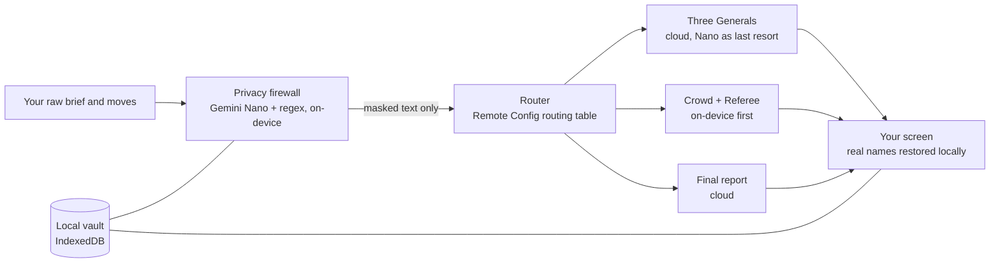

# War Room

**The cloud does the thinking, the device keeps the secrets.**

War Room is a multi-agent war game for your most confidential plans. Paste a startup idea, a pricing move or a match plan, and three AI opponents attack it for three rounds while a crowd reacts and a referee keeps score. Your real company names, people, figures and places never leave your device: Gemini Nano masks them in the browser before anything reaches the cloud, and puts them back on your screen at the end.

Built for #BuildHybridAI 2026 with Firebase AI Logic hybrid inference.

- **Live app:** https://war-room-hybrid.web.app
- **Demo video (3 min):** FILL: YouTube link
- **Chrome extension:** load unpacked from `apps/extension` (see below)

## The problem

The plans worth stress-testing are the ones you cannot paste into a chatbot: an unannounced product, a price change, a term sheet, a team sheet. Cloud models are good opponents, but sending them the real text means sending your secrets. On-device models keep the secrets but are too small to argue like a seasoned investor.

War Room splits the work so you get both.

## How the work is split

| Task | Sees | Runs on | Why there |
|---|---|---|---|
| Privacy firewall (`redact`) | your raw text | **On-device only**, locked in code | It reads the secrets, so it has no cloud route at all |
| Live coaching while you type (`referee_live`) | your raw draft | **On-device only**, locked in code | Feedback on every pause would be costly in the cloud and would leak drafts |
| Crowd reactions (`crowd`) | masked round | On-device first, cloud fallback | Frequent, short, cheap: ideal for a local model |
| Round referee (`referee_round`) | masked round | On-device first, cloud fallback | Same |
| The three Generals (`general_move`) | masked brief and history | Cloud, with Gemini Nano as last resort | Needs adversarial reasoning over a long context |
| Final report (`final_report`) | masked transcript | Cloud | Runs once, needs the strongest model |

Every AI output carries a badge saying where it actually ran (read from `response.inferenceSource`, never guessed) and how long it took. A local call ledger powers a **Hybrid telemetry** panel: share of calls on-device, cloud calls avoided, characters kept local.

## Privacy guarantees

1. **Extract, do not rewrite.** Gemini Nano only lists the names it finds. Regular expressions find money, percentages, numbers, dates, emails, URLs and phones. Code does the substitution, so `Kestrel Labs` becomes `[COMPANY_1]` exactly, every time.
2. **You approve first.** A side-by-side review shows what was removed and what the cloud will see. Nothing is sent until you click "Approve and send". Every move you type later goes through the same firewall.
3. **Privacy lock.** Tasks that see raw text are forced to on-device in code. Remote Config and URL flags cannot change that. When Gemini Nano is not available, the app falls back to a clearly labelled basic redaction instead of sending raw text.
4. **Two egress guards.** Before any cloud call, the router scans the outgoing text for every vaulted original. A second guard wraps `fetch` and blocks any request to the AI or Firestore endpoints that contains one. Cloud saves are checked the same way.
5. **The vault stays local.** The placeholder map and raw text live only in IndexedDB. Firestore rules reject any document that carries them. Saved games are always masked.
6. **See for yourself.** The Egress inspector shows the exact text of every cloud call.

## Measured, not assumed

| What | Result |
|---|---|
| Gemini Nano, one crowd call, warm | 16.7 s on an 11.8 GB RAM laptop (CPU path). It was 122 s before we constrained the output schema to exactly the requested personas |
| `gemini-3.5-flash-lite`, one General move | 2 to 10 s |
| Free-tier rate limit | 15 requests per minute per project on flash-lite, shared by all visitors |
| Cloud reliability at peak | about half of flash-lite calls failed at random on 19 Nov, so the router retries with backoff, then a second model, then Gemini Nano |
| A full game with Gemini Nano available | FILL: cloud calls and timings from the owner's test game |

## Firebase products used

- **Firebase AI Logic** (`firebase/ai`) with hybrid inference: all four modes (`ONLY_ON_DEVICE`, `PREFER_ON_DEVICE`, `PREFER_IN_CLOUD`, `ONLY_IN_CLOUD`), Gemini Developer API backend, structured output on both sides from one zod schema per task.
- **App Check** with reCAPTCHA Enterprise and limited-use tokens. The extension gets its tokens through a small hosted bridge page.
- **Authentication:** anonymous everywhere, Google sign-in on the web (linked, so saved games survive).
- **Cloud Firestore:** opt-in "Save to cloud" for masked games, owner-only rules.
- **Remote Config:** the whole routing table (mode, model, fallback, timeout per task) is one JSON parameter. Change it in the console and the badges change live.
- **Hosting:** the web app and the App Check bridge.

Everything runs on the free Spark plan. No billing account, no Cloud Functions.

## Try it

**Hosted:** open https://war-room-hybrid.web.app, pick "Startup Idea Stress Test", click "Load demo brief", then "Seal brief in privacy firewall".

**Without Gemini Nano** (phones, Firefox, Safari, smaller machines) the app still works: redaction falls back to the labelled basic mode, crowd and referee run in the cloud on masked text, and live coaching and the offline what-if are hidden with an explanation.

**With Gemini Nano** you need desktop Chrome on Windows 10/11, macOS 13+, Linux or a Chromebook Plus, 22 GB of free disk, and either a GPU with more than 4 GB of VRAM or 16 GB of RAM with 4 cores. The model downloads once, from a button in the app. Our development laptop has 11.8 GB of RAM and uses `chrome://flags/#optimization-guide-on-device-model` set to "Enabled BypassPerfRequirement"; machines that meet Google's requirement do not need the flag.

## Run it locally

Prerequisites: Node 22 or later, pnpm 10, the Firebase CLI, a Google account. Everything below is free.

1. **Firebase project** (Spark plan): create a project and register a web app.
2. **AI Logic:** in the console, enable Firebase AI Logic with the **Gemini Developer API**.
3. **App Check:** create a reCAPTCHA Enterprise key for your hosting domain (do not add `localhost`), register it for the web app, and enforce App Check for AI Logic. For local development, add a debug token in the App Check console.
4. **Authentication:** enable the Anonymous and Google providers.
5. **Firestore:** create the database, then `firebase deploy --only firestore:rules`.
6. **Remote Config:** `firebase deploy --only remoteconfig` (publishes `remoteconfig.template.json`).
7. **Environment:** copy `.env.example` to `.env` and fill in the web app config, the reCAPTCHA site key and your debug token. `.env` is git-ignored; never commit the debug token.
8. **Install and run:**

```bash
pnpm install
pnpm --filter @warroom/web dev
```

Tests and type checks:

```bash
pnpm test
pnpm typecheck
```

Deploy:

```bash
pnpm build
firebase deploy --only hosting
```

### Load the Chrome extension

```bash
pnpm --filter @warroom/extension build
```

Open `chrome://extensions`, turn on Developer mode, click "Load unpacked" and choose `apps/extension/dist`. Click the War Room icon to open the side panel, or select text on any page and choose "Stress-test selection in War Room". The extension ID is fixed by the `key` in its manifest, and the hosted App Check bridge only answers that ID; if you fork the project, update `ALLOWED_EXTENSION_ORIGIN` in `apps/web/src/bridge.ts`.

### Developer flags

| URL flag | Effect |
|---|---|
| `?mock=1` | Mock models, no network, no quota. Badges say MOCK. |
| `?forceCloud=1` | Masked tasks go to the cloud; raw-text tasks behave as if Gemini Nano were unavailable. Raw text still never leaves. |
| `?forceDevice=1` | Crowd and referee forced on-device. |

## Project layout

```
packages/core   router, prompts, zod schemas, privacy firewall, game engine, storage (no React)
packages/ui     shared React screens and components, Retro-Tactical Terminal design
apps/web        the web app (Firebase Hosting) and the App Check bridge page
apps/extension  Chrome MV3 side panel that mounts the same App
docs/           technical design, prompts, plan, design system
spike/          Day 1 to 2 experiments that settled the SDK questions
```



## Built during the submission period

Everything in this repository was written between 16 and 30 November 2026: the hybrid inference spike, the router and its fallback chain, the privacy firewall and both egress guards, the game engine, the three scenario templates, the web app, the Chrome extension and the design system. The commit history shows each step.

## License

Apache License 2.0. See [LICENSE](LICENSE).
